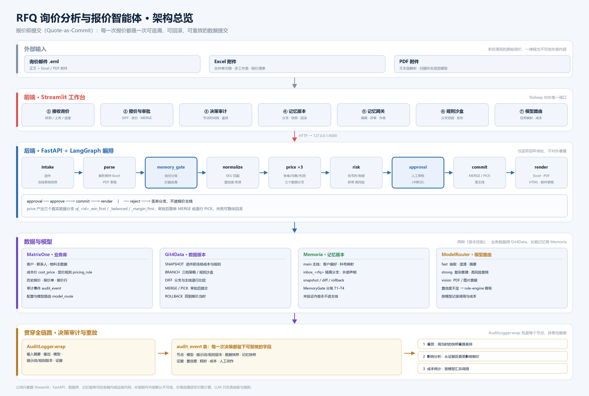

# RFQ 询价分析与报价智能体

> 把一封询价邮件（正文 / Excel / PDF）变成可解释、可审批、可审计、可回滚的报价单。

核心理念是 **报价即提交（Quote-as-Commit）**：报价、规则和记忆都像代码一样经过 `SNAPSHOT → BRANCH → DIFF → MERGE / PICK / ROLLBACK`。

- 在线体验：https://rfq-agent-production.up.railway.app/
- 说明文档：[docs/submission.md](docs/submission.md)（GitHub：https://github.com/xinzaifeixiang1992/rfq-agent/blob/main/docs/submission.md）
- 三分钟演示视频：[B 站](https://www.bilibili.com/video/BV1WLWu64EJe)（另有 [仓库内备份](docs/rfq-agent-demo.mp4)）
- 代码仓库：https://github.com/xinzaifeixiang1992/rfq-agent
- 访问方式：当前无需账号或密码；管理接口不会在公共页面显示

## 三分钟体验路径

打开在线工作台后，按页面顶部“评委演示指引”操作：

1. 点击 **Excel 样例**：解析合并单元格附件，完成物料标准化，并在三个数据分支并行生成争单、均衡、利润三档报价。
2. 进入 **报价与审批**：比较三档 DIFF；修改一行价格并批准，观察整单 `MERGE` 或按行 `PICK`。
3. 进入 **决策审计**：查看模型、规则版本、数据/记忆快照、证据与人工动作；按报价时快照重放。
4. 点击 **投毒邮件**：在 **记忆网关** 查看提示注入、隐藏文字、虚假折扣和账期如何被拦截；正常声明进入隔离分支等待评审。
5. 在 **记忆版本** 创建快照、写入记忆并回滚；在 **规则沙盒** 修改目标毛利、回测、DIFF 后再合并。
6. 在 **模型路由** 查看每个节点选用的模型、token、成本、耗时和置信度。

> 公共环境为共享演示实例。请勿上传真实客户资料；写操作按客户端 IP 限流。

## 解决的问题与业务价值

| RFQ 业务痛点 | 本项目的处理方式 | 业务价值 |
|---|---|---|
| 邮件格式不一，附件有合并单元格、跨页表格 | `.eml`、Excel、PDF、正文统一解析，低置信度逐行标记 | 减少人工抄录和漏项 |
| 客户料号与内部 SKU 不一致 | 精确、别名记忆、模糊匹配逐级处理并保留证据 | 结果可校验，不做黑盒猜测 |
| 定价依赖个人经验 | 成本、历史成交、趋势、客户画像、数量阶梯组成确定性定价引擎 | 模型故障时仍能稳定报价 |
| “当时为什么这样报”无法解释 | 节点级决策审计 + 数据/规则/记忆快照 + 时间旅行重放 | 支持复盘、问责和合规审计 |
| 改规则或记忆可能污染生产 | 在隔离分支修改，先 DIFF / 回测 / 评审，再 MERGE；可回滚 | 将试错风险限制在分支内 |
| 客户邮件可能给 Agent 植入长期错误记忆 | MemoryGate 信任分级、隔离评审、主线扫描、影响分析 | 防止一次投毒影响后续所有报价 |

目标用户是外贸销售、报价专员、销售主管和财务/审计人员。Agent 自动完成高重复的解析、查价、策略比较和文档生成，但报价进入主线前始终保留人工审批。

## 架构

```text
浏览器
  │
  ▼
Streamlit 工作台（Railway 对外唯一端口）
  │  容器内 API_BASE=http://127.0.0.1:8000
  ▼
FastAPI ── LangGraph
  intake → parse → MemoryGate → normalize → price×3 → risk → 人工审批 → commit → render
     │         │            │              │                         │          │
     │         │            └─ inbox 分支   └─ 三个 quote_line 分支   └─ MERGE/PICK
     │         └─ Excel / PDF / 正文
     ├─ ModelRouter：按任务、复杂度和置信度选择模型，可降级规则引擎
     └─ AuditHook：输入摘要、输出、模型、提示词/规则版本、证据、快照、人工动作

MatrixOne / Git4Data                       Memoria
业务表、成本、历史、规则、报价、审计        客户画像、料号映射、程序性/情景记忆
SNAPSHOT / BRANCH / DIFF / PICK / MERGE    branch / diff / snapshot / rollback
```



> 上图由 `scripts/make_architecture_png.py` 生成，随代码修改重绘；另有系统分层、单张询价完整链路、审计与重放三张 Mermaid 图与关键取舍表，见 [docs/architecture.md](docs/architecture.md)。

### 四项赛题核心能力

| 核心能力 | 业务实现 | 关键代码 |
|---|---|---|
| Git for Data | 进件即冻结成本和规则；三档策略各开分支；审批使用 MERGE/PICK；规则在分支沙盒回测 | `app/vcs/`、`app/workflow.py` |
| 决策审计 | 每个节点记录模型、提示词/规则版本、快照、证据、置信度、耗时、成本和人工动作 | `app/audit/hook.py` |
| 记忆版本控制 | 学习记忆先入分支，支持 DIFF、评审、快照、回滚；与报价审计互相引用 | `app/memory/` |
| 模型路由 | 路由配置存数据库，按任务选择 fast / strong / vision；LLM 不可用时降级规则引擎 | `app/router/` |

### 一次报价的生命周期

1. `intake`：接收邮件和附件，创建 RFQ ID，并冻结数据与记忆版本。
2. `parse / normalize`：抽取客户、币种、贸易术语、交期和物料；料号匹配保留方法与分数。
3. `MemoryGate`：邮件是外部不可信输入，候选长期记忆必须经过 block / review / skip 判定。
4. `price / risk`：在三个数据分支生成三档报价，确定性引擎计算价格，LLM 只做字段抽取和文本生成。
5. `interrupt`：LangGraph 在人工审批前暂停；销售可选策略、选行、改价或驳回。
6. `commit / render`：整单有效则 MERGE，部分采用则 PICK；生成 Excel、PDF、HTML 和回复邮件草稿。
7. `learn`：成交/丢单和人工改价形成候选经验，经分支评审后才能进入记忆主线。

## MemoryGate：防止记忆投毒

单次提示注入不可直接改变价格，但一旦写成长期记忆，会污染未来每次报价。MemoryGate 因此位于“外部内容 → 长期记忆”的强制边界。

| 判定 | 示例 | 处理 |
|---|---|---|
| `block` | “忽略之前指令”、PDF 白色小字、零宽字符、伪造角色、低于成本的协议价、超限折扣/账期 | 不写入记忆；记录原因；本单增加高风险告警 |
| `review` | 新料号映射、客户偏好、可疑但非恶意的敏感声明 | 写入 `inbox_<rfq>` 隔离分支（T4），人工批准后升级 T3 |
| `skip` | 与客户主数据或现有记忆一致 | 不重复写入 |

- T1：主数据/人工确认；T2：内部审批产生；T3：外部声明经评审通过；T4：未验证、永不参与决策。
- 合并前自动创建 `pre_merge_*` 快照；存量扫描隔离前创建 `pre_quarantine_*` 快照。
- `GET /memory/{id}/impact` 从审计证据反查受影响报价单，支持召回和修复。
- Memoria 云分支 DIFF 若出现 lineage 异常或超时，在 `pre_merge` 快照保护下使用可审计降级路径；不会静默放行。

### 投毒评测结果

`eval/poison_cases/cases.json` 包含 16 条攻击和 14 条良性样本；`eval/run_poison.py` 可复现报告。

| 指标 | 当前结果 |
|---|---:|
| 攻击直接拦截率 | 87.5%（其余 2 条进入高风险人工评审，不进主线） |
| 攻击不进入主线比例 | 100% |
| 良性误拦截率 | 0% |
| 与预期判定一致率 | 100% |
| 端到端检查 | 13 / 13 通过 |
| 遗留投毒影响与恢复 | 0.4348 → 0.4134 → 隔离后 0.4348 |

## 技术栈

- Python 3.13、LangGraph、Pydantic 2
- FastAPI、Uvicorn、Streamlit
- MatrixOne / Git4Data、PyMySQL
- Memoria REST（Git for Memory）
- OpenAI 兼容 LLM / MOI Genesis
- `openpyxl`、`pdfplumber`、`reportlab`、Jinja2、pandas
- pytest、Docker、Railway

## 验证结果

- 常规自动化测试：`169 passed, 8 skipped`（local / git4data-sim / fake Memoria）。
- 真实 MatrixOne Git4Data：完整 8 用例历史通过；本次变更后核心快照、DIFF、MERGE/PICK 6 用例复验通过，Git4Data 记忆实验后端的 2 个远端用例因云端长耗时未在 10 分钟内结束（线上使用 Memoria，不走该实验路径）。
- 真实 MatrixOne + Memoria + LLM 在线冒烟：四封样例、MERGE/PICK/驳回、重放、规则沙盒、记忆回滚、MemoryGate 全链路 `ALL OK`。
- 安全回归：管理开关与 token、健康检查脱敏、写接口限流、上游超时 503、Memoria 快照列表超时降级均有测试覆盖。

本地运行测试：

```powershell
.\.venv\Scripts\python.exe -m pytest -q
$env:RFQ_TEST_MO="1"
.\.venv\Scripts\python.exe -m pytest tests\test_vcs_matrixone.py -q
```

## 本地运行

```powershell
python -m venv .venv
.\.venv\Scripts\pip.exe install -r requirements.txt
copy .env.example .env
.\.venv\Scripts\python.exe scripts\make_samples.py
.\.venv\Scripts\python.exe scripts\seed.py
.\.venv\Scripts\python.exe -m uvicorn app.api.main:app --port 8000
# 另开终端
.\.venv\Scripts\python.exe -m streamlit run web/app.py --server.port 8501
```

浏览器打开 `http://localhost:8501`。默认示例配置可使用 SQLite + Git4Data 仿真 + 规则引擎，不需要云端凭据。

## 配置与 Railway 部署

复制 `.env.example` 并使用环境变量覆盖。密钥只允许进入本地 `.env` 或 Railway Variables，不写入代码、日志、截图或仓库。

生产环境主要变量：

```dotenv
DB_BACKEND=matrixone
MEMORY_BACKEND=memoria
MO_HOST=
MO_PORT=6001
MO_USER=
MO_PASSWORD=
MO_DATABASE=rfq_agent_v2
MO_INIT_COMMAND=
MO_CONNECT_TIMEOUT=10
MO_READ_TIMEOUT=120
MO_WRITE_TIMEOUT=60
MO_DIFF_TIMEOUT=12
MEMORIA_URL=https://api.thememoria.ai
MEMORIA_API_KEY=
LLM_BASE_URL=
LLM_API_KEY=
MODEL_FAST=
MODEL_STRONG=
MODEL_VISION=
API_BASE=http://127.0.0.1:8000
DEMO_MODE=true
ADMIN_TOKEN=
ALLOW_ADMIN_RESET=false
RATE_LIMIT_WRITES=30
RATE_LIMIT_WINDOW=60
```

Railway 使用根目录 `Dockerfile` 构建。容器只公开 Streamlit 的 `$PORT`，FastAPI 仅监听 `127.0.0.1:8000`。`railway.json` 已配置 `/_stcore/health` 健康检查和失败重启。

首次初始化流程：

1. 在 Railway Variables 填写轮换后的 MatrixOne、Memoria、LLM 凭据和高强度 `ADMIN_TOKEN`。
2. 临时设 `ALLOW_ADMIN_RESET=true`，部署后通过管理模式调用一次 reset。
3. 立即改回 `ALLOW_ADMIN_RESET=false` 并重新部署。
4. 在无痕浏览器验证四封样例、审批、重放、规则沙盒、记忆回滚和 MemoryGate。

公网管理模式仅用于初始化/录制：访问 `https://<domain>/?admin=1` 并输入口令。开关关闭时，即使口令正确也无法调用管理接口。

## 项目结构

```text
app/                 FastAPI、LangGraph、解析、定价、审计、VCS、记忆与 MemoryGate
web/app.py           Streamlit 七页签评委工作台
samples/             四封合成演示邮件与附件
scripts/             初始化、能力探测、在线冒烟、Railway 启动脚本
eval/                投毒用例、评测脚本与报告
tests/               自动化测试
Dockerfile           Streamlit + FastAPI 单容器部署
railway.json          Railway 构建、健康检查与重启策略
docs/                 视频脚本、评委验收清单与脱敏截图
```

## 数据合规与安全

- 客户、联系人、邮箱、物料、成本、历史报价和邮件均由 `app/seed.py`、`scripts/make_samples.py` 固定随机种子生成，不含真实业务数据。
- 外部邮件默认不可信；LLM 只负责抽取与措辞，价格由确定性引擎计算，所有长期记忆写入必须经过 MemoryGate。
- 报价必须人工审批后进入主线；关键动作可追溯到数据、规则和记忆版本，并支持回滚。
- 公网 API 不直接暴露；管理接口需 `ALLOW_ADMIN_RESET=true` 和恒定时间比较的 `X-Admin-Token` 双重校验。
- `/health` 只返回组件类型和状态，不返回主机、数据库名、用户名、连接串、密钥或管理口令。
- `.gitignore` / `.dockerignore` 排除 `.env`、本地数据库、上传件、输出、日志、缓存和 Memoria 参考源码。
- 外部服务凭据应在提交前轮换，并由 Railway Variables 托管。

## 已知限制

- 演示实例为单容器、单 worker；所有访问者共享演示数据。进程内限流适合比赛演示，不代替网关级限流。
- LangGraph checkpointer 当前为内存版，容器重启后未完成的审批状态可能丢失；已完成决策仍在数据库审计表中。
- 记忆后端的当前分支是实例状态，当前以单 worker 避免跨请求竞争；生产多租户需改为请求级分支上下文。
- Railway 本地文件系统非持久化，生成的报价文件在重启后丢失；正式环境应接入对象存储。
- Memoria 免费/当前服务有快照配额，客户端只回收本应用创建的最旧注册快照；快照列表异常时短超时并回退本进程已知列表。
- **MatrixOne 表级快照配额（免费额度硬限制，50 个）**：当前使用的免费 Serverless 实例对表级快照（`CREATE SNAPSHOT ... FOR TABLE`）有账户级上限 50 个。本应用每单为 `cost_price`、`pricing_rule` 各建 1 个快照，即 2 个/单，约 25 单即达上限；超限后 `CREATE SNAPSHOT` 返回 `20101 ... has reached the limit of 50`，会被统一兜底转换为 **503「数据库连接暂时不可用，请稍后重试」**，实际原因是配额而非连接故障。`MatrixOneVCS.snapshot()` 已实现自动回收最旧询价单快照后重试，也可手动执行 `python scripts/prune_snapshots.py --keep 0` 立即释放配额。
- MatrixOne Git4Data 与外部模型属于远程依赖，代码已配置有界超时和可审计降级，但公网延迟会影响单次处理时长。

## 交付材料

- 说明文档（提交版）：[docs/submission.md](docs/submission.md)
- 视频分镜与旁白：[docs/demo_video_script.md](docs/demo_video_script.md)
- 点击级录制台本：[docs/demo_walkthrough.md](docs/demo_walkthrough.md)
- 字幕与念读稿：[docs/subtitle.md](docs/subtitle.md)
- 评委逐项验收：[docs/judge_checklist.md](docs/judge_checklist.md)
- 页面截图：[docs/screenshots/](docs/screenshots/)

## 离线演示（断网/无云凭据）

```powershell
# 一键起：SQLite + Git4Data 仿真 + 规则引擎，预置四封样例（一单已提交、三单待审批）
powershell -ExecutionPolicy Bypass -File scripts\offline_demo.ps1

# 重建演示现场 / 结束服务
powershell -ExecutionPolicy Bypass -File scripts\offline_demo.ps1 -Reset
powershell -ExecutionPolicy Bypass -File scripts\offline_demo.ps1 -Stop
```

环境变量只在脚本进程内覆盖，不改 `.env`；离线库为 `data/rfq_offline.db`，与日常库隔离。

本项目仅用于比赛演示与技术验证，不建议未经权限、持久化和并发改造直接用于生产报价。