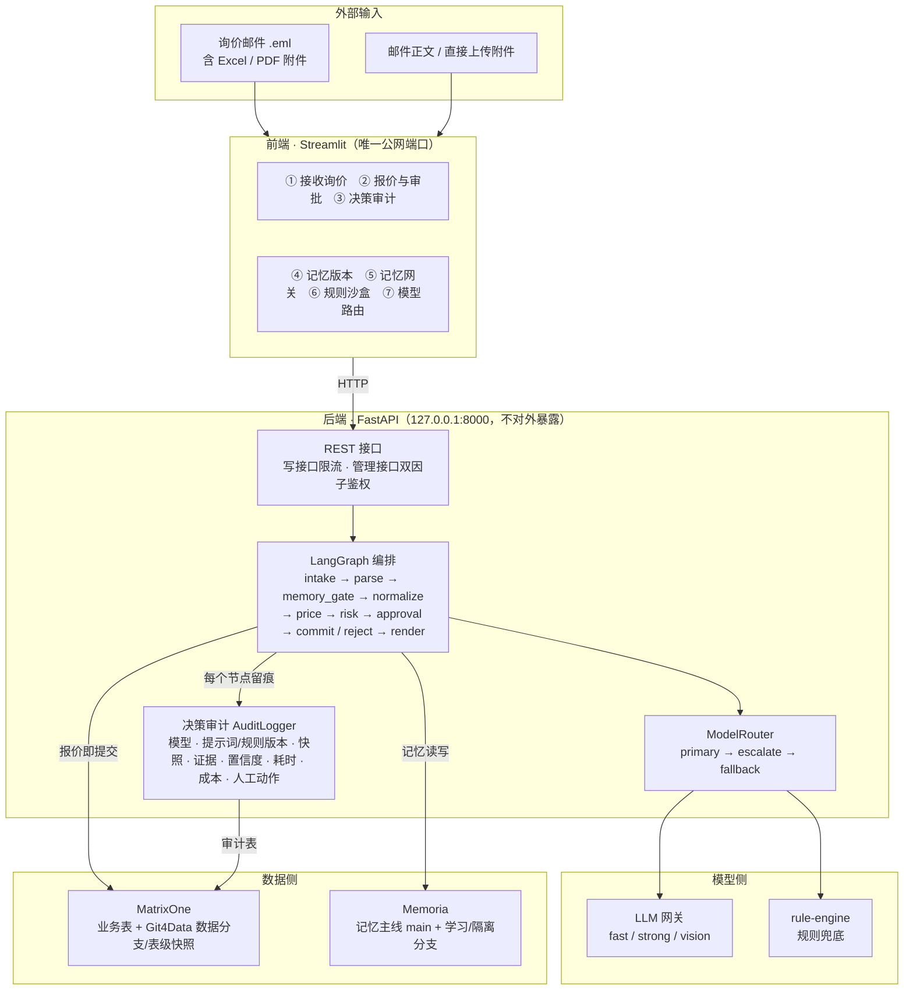
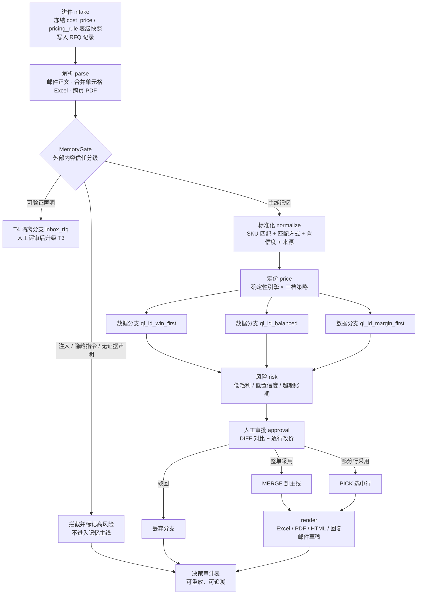
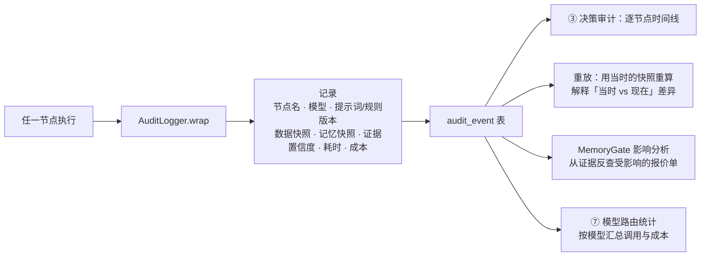

# 架构图

三张图分别回答：**系统怎么分层**、**一张询价单怎么走完全程**、**三档策略与 Git4Data 怎么落地**。图用 Mermaid 编写，GitHub 直接渲染；需要 PNG 时可粘贴到 <https://mermaid.live> 导出。

## 一、系统分层

## 二、一张询价单的完整链路

## 三、审计与重放为什么可信

## 关键设计取舍

| 取舍 | 选择 | 原因 |
|---|---|---|
| 谁算价 | 确定性引擎算价，LLM 只做抽取与措辞 | 价格必须可复现、可审计；LLM 输出不可作为定价依据 |
| 外部内容能否直接进记忆 | 一律先入隔离分支，评审后升级 | 防止记忆投毒污染后续所有报价 |
| 三档策略怎么存 | 三个真实数据分支，不是三份临时表 | 比较、回滚、合并都走 Git4Data 原生语义，而不是应用层模拟 |
| 未审批能否出价 | 不能，`approval` 是图上的中断点 | 报价必须人工确认后才落主线并生成对外文件 |
| 模型挂了怎么办 | 路由降级到 rule-engine，不阻断业务 | 外部模型不可用时仍能产出报价，审计里如实记录降级 |
| 前后端如何暴露 | 只公开 Streamlit 端口，FastAPI 仅监听回环地址 | 减小公网攻击面，管理接口再加 token 校验 |

## 对应代码

| 图上模块 | 代码位置 |
|---|---|
| LangGraph 编排 | `app/graph/builder.py`、`app/graph/nodes.py` |
| 审计留痕 | `app/audit/hook.py` |
| 模型路由 | `app/router/router.py`、`app/router/llm.py` |
| Git4Data 分支与快照 | `app/vcs/matrixone.py`、`app/vcs/sqlite_sim.py` |
| 记忆与网关 | `app/memory/memoria.py`、`app/memory/gate.py` |
| 定价与风险 | `app/pricing/engine.py`、`app/pricing/rules.py`、`app/pricing/risk.py` |
| 解析器 | `app/parsers/` |
| 前端 | `web/app.py` |
| REST 接口 | `app/api/main.py` |
